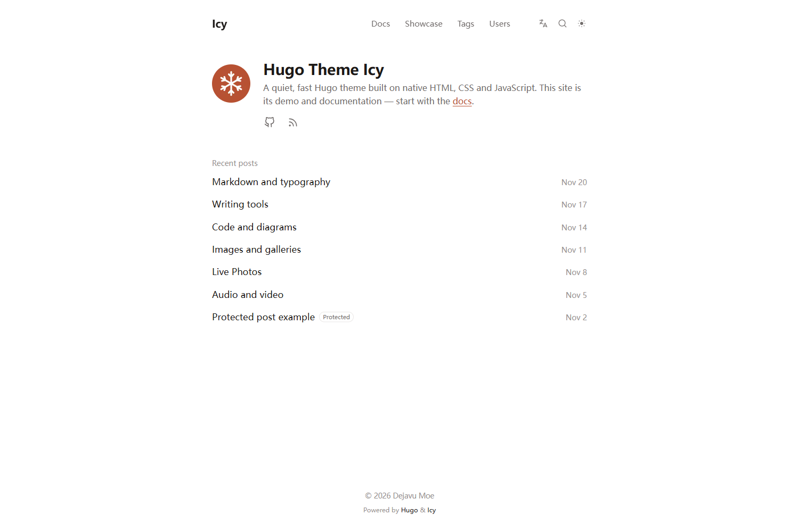

# Icy

A quiet, fast Hugo theme for personal blogs, made of plain HTML, CSS and JavaScript.

English · [简体中文](README.zh-CN.md)



## Features

- One accent color of your choice, in light and dark schemes that follow the system.
- Made for reading: a table of contents beside long posts, footnote previews, alerts, code blocks with a copy button, diagrams.
- Images with a zoom viewer, galleries, live photos, an audio player with playlists, video, YouTube embeds that load on click.
- Password-protected posts, encrypted after the build.
- Search, yearly archives, a tag index, friends and changelog pages.
- Multilingual, with English and Simplified Chinese built in.
- SEO, RSS, Ecoku comments and Plausible analytics.
- No framework, no npm. Every page works without JavaScript and loads only what it uses.

## Quick start

You need Hugo 0.158.0 or later (the standard edition) and Git.

```sh
git submodule add https://github.com/DejavuMoe/hugo-theme-icy.git themes/hugo-theme-icy
```

Then set the theme and the Markdown settings it needs in `hugo.toml`:

```toml
theme = 'hugo-theme-icy'

[markup.goldmark.parser]
  wrapStandAloneImageWithinParagraph = false
  [markup.goldmark.parser.attribute]
    block = true
```

Preview the site at <http://localhost:1313/>:

```sh
hugo server
```

## Documentation

Everything else is in the docs: **<https://icy.zsh.moe/docs/>**. The [demo site](https://icy.zsh.moe/) shows each feature in use.

## License

[MIT](LICENSE) © 2026 Dejavu Moe.

Bundled third-party components:

- Tabler Icons — MIT — [license](assets/icons/tabler.LICENSE)
- Pele, with one Lucide icon — MIT and ISC — [license](assets/js/vendor/pele.LICENSE)
