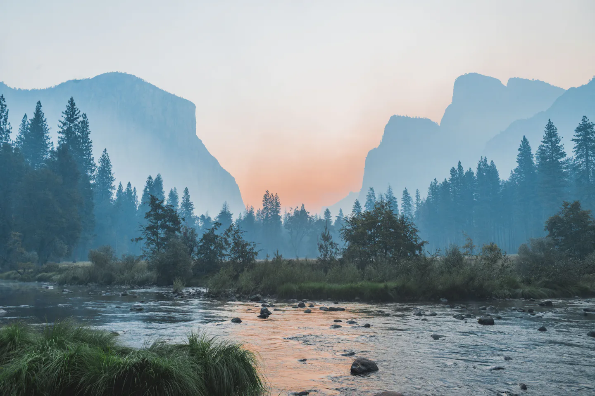
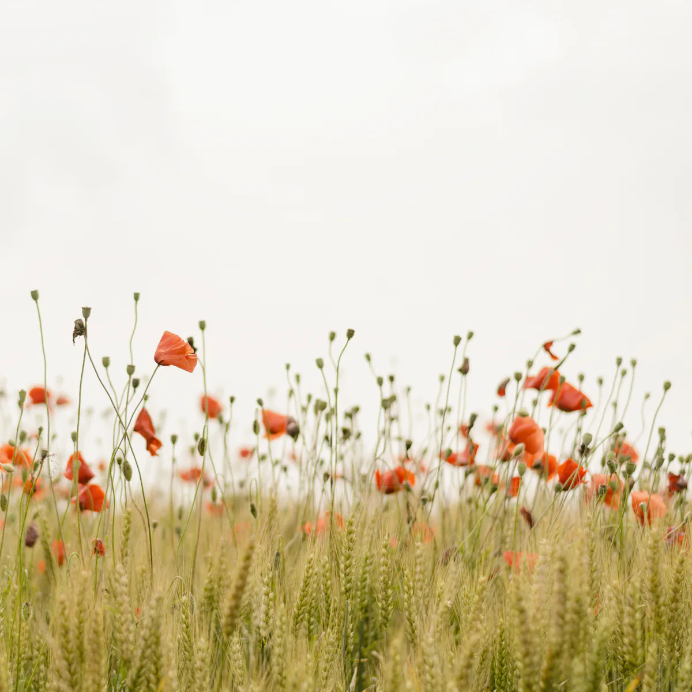
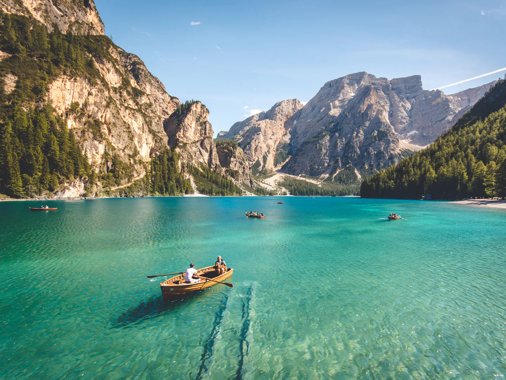

+++
title = 'Images and galleries'
date = 2026-11-11T10:00:00+08:00
images = ['covers/images-and-galleries.webp']
description = 'A year of walks in photos: single images, figures and justified galleries.'
tags = ['Images', 'Media', 'Shortcodes']
categories = ['Examples']
+++

How to add photos like these: [Media](/docs/media/). Live Photos have [their own post](/posts/live-photos/).

A year of walks, in photos. Click any of them to see it large, then use the arrow keys or swipe to move through the rest.

## Valleys and lakes

In May the poppies  were everywhere, and by June the boats were back on the lake.

## A few favourites













## Galleries


  
  
  



  
  
  
  



  
  
  
  
  
  
  


## Credits

The photos are from [Unsplash](https://unsplash.com/), free to use under the [Unsplash License](https://unsplash.com/license).
