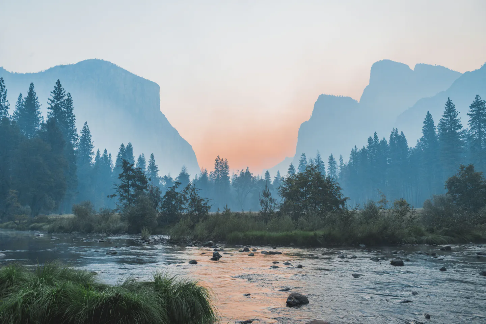
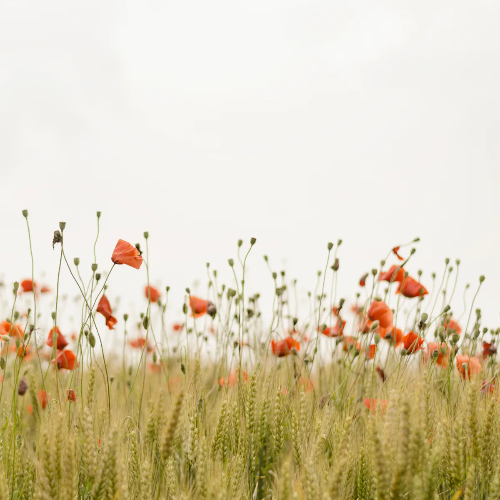
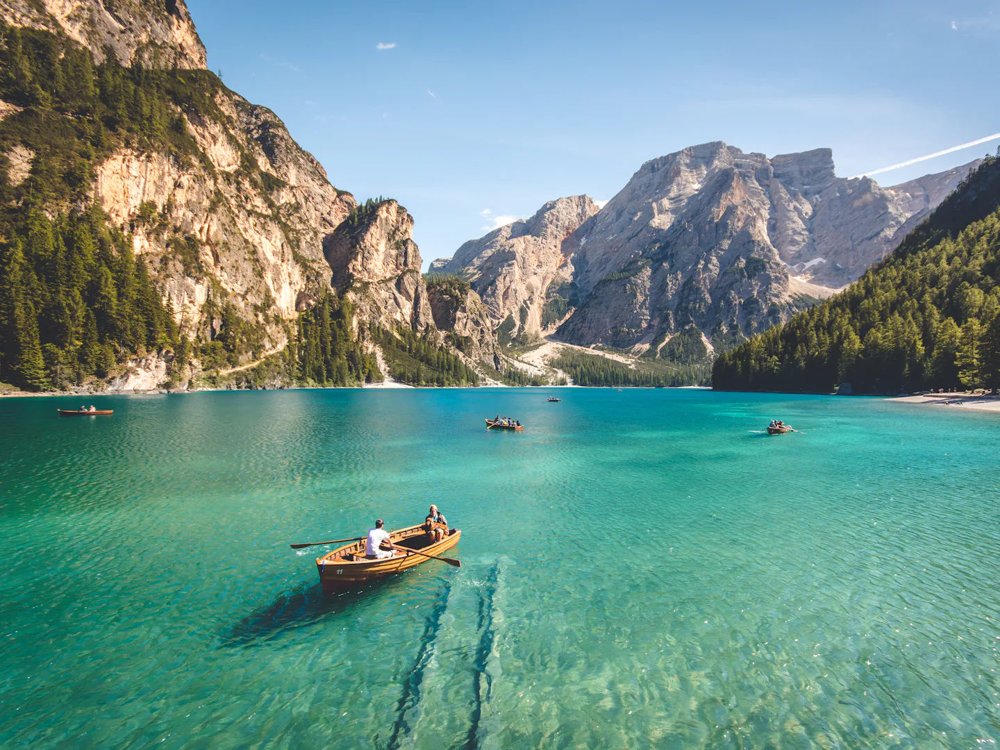

+++
title = '图片与画廊'
date = 2026-11-11T10:00:00+08:00
images = ['covers/images-and-galleries.webp']
description = '一年的徒步照片：单张图片、figure 和等高画廊。'
tags = ['图片', '媒体', '短代码']
categories = ['示例']
+++

这些图片的写法见 [媒体](/docs/media/) 文档。实况照片单独放在 [另一篇](/posts/live-photos/) 里。

一年里走过的路，留下这些照片。点击任意一张查看大图，再用方向键或滑动手势浏览其余的照片。

## 山谷与湖

五月里到处都是虞美人 ，到了六月，湖上的小船也回来了。

## 几张偏爱的













## 画廊


  
  
  



  
  
  
  



  
  
  
  
  
  
  


## 素材来源

照片来自 [Unsplash](https://unsplash.com/)，按 [Unsplash License](https://unsplash.com/license) 免费使用。
