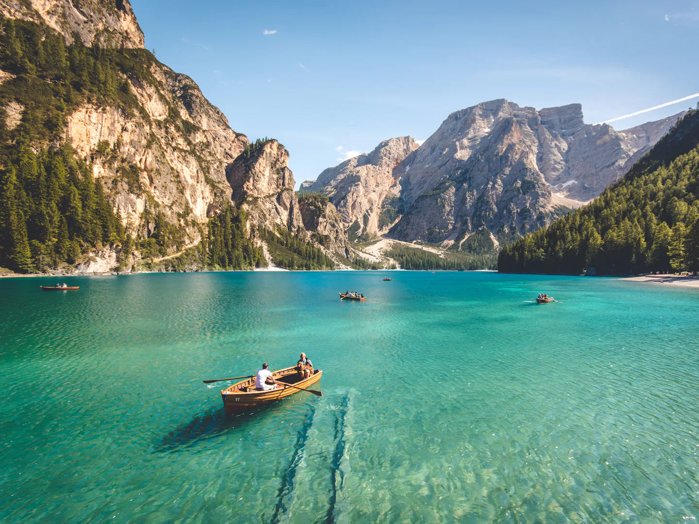
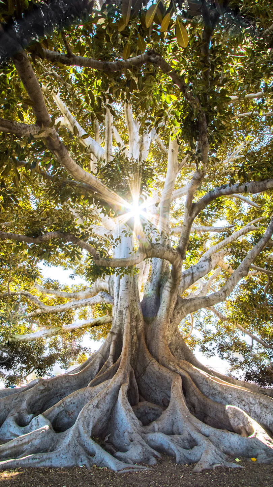

+++
title = 'Markdown and typography'
date = 2026-11-20T10:00:00+08:00
images = ['covers/markdown-and-typography.webp']
description = 'A weekend walk written in plain Markdown: text, lists, tables, quotes, alerts and footnotes.'
tags = ['Markdown', 'Typography']
categories = ['Examples']
+++

How to write all of this: [Writing](/docs/writing/).

Notes from a weekend in the hills, written in plain Markdown and nothing else. The same file reads just as well on GitHub or in a text editor.

## Getting there

The early train leaves at seven, which is **early enough**, *just*. I had planned to take the bus ~~on Friday night~~, but the train is quieter and the coffee is better. The route is marked on [OpenStreetMap](https://www.openstreetmap.org/), and more photos from these walks are in the [gallery post](/posts/images-and-galleries/).

Note to self: <mark>book the window seat</mark>, bring water (H2O, plenty of it), and remember that the <abbr title="Estimated time of arrival">ETA</abbr> is a hope, not a promise. The ticket machine wants the station code, `LKJ`. The guidebook calls the walk "easy", which is true for pages 10--20 and less so after that---the last climb is steep. We'll see...

Weather: :sunny: on Saturday, :umbrella: on Sunday. Packed anyway 🧊 🌿 ☕.

## What to pack

- Boots, broken in
- A warm layer
  - Wool, not cotton
  - One spare pair of socks
- Something to read

The plan, in order:

1. Take the early train
2. Walk to the lake
   1. Stop at the bridge
3. Be back before dark

So far:

- [x] Book the train
- [x] Charge the camera
- [ ] Pack

## The route

| Day | Distance | Climb |
| :--- | :---: | ---: |
| Saturday | 14 km | 620 m |
| Sunday | 9 km | 310 m |

The trains, for the record:

| Train | Departs | From | Arrives | At | Platform | Notes |
| --- | --- | --- | --- | --- | --- | --- |
| RE 4512 | 07:12 | Central Station | 09:05 | Lake Junction | 3 | Bicycles allowed, quiet carriage at the front |
| RE 4537 | 16:48 | Lake Junction | 18:40 | Central Station | 1 | The last direct train of the day |

### Saturday

The lake sits at about 1,600 metres[^height], and the boats were already out when we arrived.

### Sunday

Rain in the morning, then light through the trees on the way down. The hut at the bottom serves soup until three[^soup].

#### A note on the map {#map}

The old path past the quarry is closed. Follow the new signs.

## Before you go

> [!NOTE]
> The last direct train back leaves at 16:48.

> [!TIP]
> Buy the return ticket in the morning. The machine at the lake only takes coins.

> [!IMPORTANT]
> Tell someone where you are going.

> [!WARNING]
> The path by the bridge floods after heavy rain.

> [!CAUTION]
> Don't feed the deer, however politely they ask.

> [!TIP] Pack light
> Everything you carry up, you carry down again.

## Borrowed words

> Simplicity is prerequisite for reliability.

> The best way to predict the future is to invent it.
>
> — Alan Kay

> Programs must be written for people to read, and only incidentally for machines to execute.
>
> ——Harold Abelson, *Structure and Interpretation of Computer Programs*

## Mixed scripts

The sign at the trailhead was bilingual: 前方 2 公里是湖，夏季开放到 18 点。 The [Chinese version of this post](/zh-cn/posts/markdown-and-typography/) shows Chinese typography in more depth.

---

Until next weekend.
{.align-center}

Written on the train home, Sunday evening.
{.align-right}

[^height]: According to the sign at the station, anyway. My phone said 1,580.
[^soup]: Lentil, mostly. The hut is on [OpenStreetMap](https://www.openstreetmap.org/) too.
