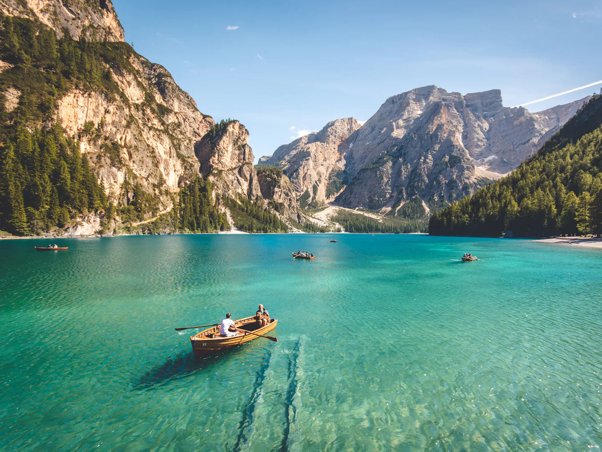

+++
title = 'Markdown 与排版'
date = 2026-11-20T10:00:00+08:00
images = ['covers/markdown-and-typography.webp']
description = '用纯 Markdown 写的一次周末徒步：文字、列表、表格、引用、提示块和脚注。'
tags = ['Markdown', '排版']
categories = ['示例']
+++

这些写法见 [写作](/docs/writing/) 文档。

周末进山走了两天，回来用纯 Markdown 记了下来，没有用任何 shortcode。同一个文件放到 GitHub 或者编辑器里也一样好读。

## 出发

早班火车七点开，**有点早**，不过 *刚好* 赶得上。本来打算 ~~周五晚上~~ 坐大巴，后来还是选了火车：安静，咖啡也好喝。路线在 [OpenStreetMap](https://www.openstreetmap.org/) 上能找到，这几次徒步拍的照片放在 [画廊那篇](/posts/images-and-galleries/) 里。

给自己的备忘：<mark>订靠窗的座位</mark>，多带水（H2O，越多越好），还有，<abbr title="预计到达时间">ETA</abbr> 只是个愿望。售票机上要输入车站代码 `LKJ`。

天气：周六 :sunny:，周日 :umbrella:。东西照样带齐 🧊 🌿 ☕。

## 行李

- 磨合过的登山鞋
- 一件保暖层
  - 羊毛的，别穿棉的
  - 多带一双袜子
- 一本书

按顺序来：

1. 坐早班火车
2. 走到湖边
   1. 在桥边歇一会儿
3. 天黑前回来

目前进度：

- [x] 订火车票
- [x] 相机充好电
- [ ] 收拾行李

## 路线

| 日期 | 距离 | 爬升 |
| :--- | :---: | ---: |
| 周六 | 14 公里 | 620 米 |
| 周日 | 9 公里 | 310 米 |

顺手记下车次：

| 车次 | 发车 | 出发站 | 到达 | 到达站 | 站台 | 备注 |
| --- | --- | --- | --- | --- | --- | --- |
| RE 4512 | 07:12 | 中央车站 | 09:05 | 湖畔枢纽站 | 3 | 可以带自行车，前面一节是安静车厢 |
| RE 4537 | 16:48 | 湖畔枢纽站 | 18:40 | 中央车站 | 1 | 当天最后一班直达车 |

### 周六

湖面海拔大约 1600 米[^height]，我们到的时候，船已经在水上了。

### 周日

早上下雨，下山路上阳光从树缝里漏下来。山脚的小屋卖汤，卖到下午三点[^soup]。

#### 关于地图 {#map}

采石场旁边的老路已经封了，跟着新路牌走。

## 出发前

> [!NOTE]
>
> 回程最后一班直达车 16:48 发车。

> [!TIP]
>
> 早上就把回程票买好，湖边的售票机只收硬币。

> [!IMPORTANT]
>
> 告诉家里人你要去哪儿。

> [!WARNING]
>
> 下过大雨后，桥边那段路会被淹。

> [!CAUTION]
>
> 别喂鹿，它们再怎么讨要也别喂。

> [!TIP] 轻装上阵
>
> 背上山的每样东西，都得再背下来。

## 别人的话

> 简单是可靠的前提。

> 人生如逆旅，我亦是行人。
>
> ——苏轼《临江仙·送钱穆父》

> The best way to predict the future is to invent it.
>
> — Alan Kay

## 中西文混排

山口的指示牌写着：前方 2 km 是湖，夏季开放到 18:00，Wi-Fi 信号很弱。

全角标点连在一起也不会显得松散：「我们走吧。」（他说。）《徒步指南》——这一行全是全角标点。

中文的 *强调* 不用斜体，而是稍微加重，比 **粗体** 轻一级。

---

下周末见。
{.align-center}

周日晚上，写于回程的火车上。
{.align-right}

[^height]: 车站的牌子上是这么写的，我的手机显示 1580 米。
[^soup]: 大多是扁豆汤。小屋在 [OpenStreetMap](https://www.openstreetmap.org/) 上也标出来了。
